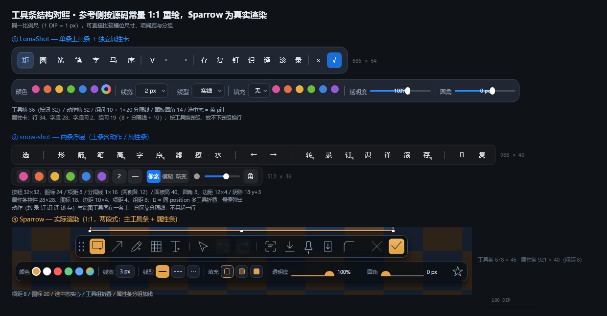
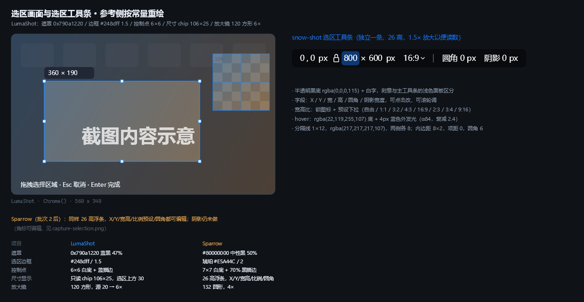

# 参考实现解剖与对齐清单

对照对象：

| 参考 | 技术栈 | 源码位置 |
|---|---|---|
| LumaShot | Win32 + Direct2D 全手绘 | `D:\mycodeHub\LumaShot\src` |
| snow-shot | Qt Widgets + 自研 Ad* 控件 | `%TEMP%\snow-shot\snow_shot` |

本文记录**布局、画面、功能**三件事的实测参数与结构，供后续对齐时逐条核对。

---

## 〇、这份文档的可信度

所有数值分三档标注，不要混用：

| 标记 | 含义 | 例子 |
|---|---|---|
| **实测** | 直接来自源码常量或布局函数，可直接照抄 | `kButtonSize = 32` |
| **推导** | 由源码的几何算法算出，但依赖默认参数 | LumaShot 默认工具条宽 686 |
| **目视** | 从渲染图量出来的 | Sparrow 工具条实测 796 × 46 |

三套界面的图：



- 上两条（LumaShot / snow-shot）是**按源码常量 1:1 重绘**的示意图，图标用文字代替，几何、间距、颜色、圆角都是真实值。
- 最下一条是 Sparrow 的**真实渲染**，同一比例尺，可以直接比长短。



### 读了什么、没读什么

| 覆盖度 | 文件 |
|---|---|
| **全读** | `LumaShot/src/ui/toolbar.cpp`（379 行）、`toolbar_render.cpp`（122 行）、`render.cpp::Chrome`、`annotation_palette.h`、`screenshotselectiongeometry.*`（512 行）、`screenshotselectionmodel.h`、`screenshotoverlayinputhandler.h`、选区工具条的常量与字段行为 |
| **精读关键段** | `screenshottoolbarlayoutmodel.h`（positions / 折叠 / 默认值）、`screenshottoolbarmainpanel.cpp`（常量与 paintEvent）、`screenshottoolpalette.cpp` 的 `createMainToolbar` / `applyMainToolbarLayout` / `addMainToolButtons` / 折叠弹出、`screenshotselectiontoolbarwidget(.h/.cpp)` 的常量与布局构建、`screenshotcanvasrenderer.cpp` 的选区绘制、`screenshotoverlayinputhandler.cpp` 的按下/松开/右键、`screenshotselectionmodel.cpp` 的 `adjustFromToolbar` / `selectionRectForDrag` |
| **只看结构** | `screenshottoolpalettestylecontrols.*`（类结构与 family 列表，未逐条读控件构建）、`screenshotcolorpickercontroller.h`（公开 API，未读 .cpp） |
| **未读** | 多区域路径合成与布尔运算实现（`screenshotregiongeometry.*`）、`ui/controls.cpp` 全量、`model/toolbar_customization.h`、`screenshotselectionshadowrenderer.cpp`（87 KB） |

结论：**工具条与选区的模型/几何/输入优先级是逐行读过的**；渲染细节（阴影、多区域布尔、属性控件构建）仍是按常量与截图推断。

---

## 一、一句话结论

三套东西不是一个思路：

- **LumaShot = 一条固定槽位的工具条 + 一张按工具换内容的属性卡**。工具全部平铺，靠「收进更多」解决溢出；属性卡是独立浮卡，会自己换行。
- **snow-shot = 两条浮层 + 二维 `positions` 折叠模型**。主条里「绘图工具 + 动作」同排，第二条是按 family 换内容的属性面板；同一 position 内的多个工具折叠成一个按钮，悬停弹出；尺寸信息在**选区上方的独立 26 高小条**里。
- **Sparrow = 一条平铺工具条 + 一条平铺属性条**。没有分组分隔线、没有折叠、没有换行、没有自定义。

差距最大的不是「少了哪些工具」，而是**信息密度和分组手段**：Sparrow 用间距 2 把所有按钮挤在一起，参考用 8 的间距 + 分隔线 + 分组标题把同样多的东西排得能读。

---

## 二、LumaShot

### 2.1 工具条几何（`src/ui/toolbar.cpp` `PlaceToolbar`）

一条水平条，**按固定槽位排布，不拉伸**。分两段：

```
[左内边距 12] 工具槽 36 步距（按钮 32 宽）…
              [7] 动作槽 32（组内相邻）
                  组间 +10，并画 1×20 分隔线
```

| 项 | 值 | 来源 |
|---|---|---|
| 工具槽步距 | 36 | `36.f*float(toolSlots)` |
| 工具按钮 | 32 宽 × 32 高（槽内左右各让 4） | `{x, y, x+w-4*s, y+32*s}` |
| 动作槽 | 32 × 32（左右各让 1） | `{x+1*s, top, x+31*s, top+32*s}` |
| 组间 | 10（工具段与动作段之间是 7 的余量） | `x+=10*s` |
| 分隔线 | 1 × 20，画在相邻按钮间隙中点 | `divider.bounds={x-.5, y-10, x+.5, y+10}` |
| 上边距 | 11 | `t.tools={12*s,11*s,…}` |
| 条高 | `18 + 工具行高`（默认 54） | `barHeight=18+toolHeight` |
| 面板圆角 | 14 | `Kind::Surface` → `p.surface(b,14*s)` |
| 按钮圆角 | 7 | `Theme::Radius()=7*scale` |
| 图标 | 最大 28，居中缩放到按钮内 | `min(w,h,28*scale)` |

条宽公式（图标模式，能放下时）：

```
groupedActions = 32 * (7 + 可用快捷动作数) + 20
groupedWidth   = 12 + 36 * 工具槽数 + 7 + groupedActions + 11
```

默认 7 个工具、5 个快捷动作 → **686 × 54**。放不下（`groupedWidth > 监视器宽-16`）才退化成网格换行。

窄屏保护：`scale = min(scale, 监视器宽 / 304)`，保证点击目标不小于 304 DIP 的等效宽度。

### 2.2 属性卡：按工具给不同的组

属性**不是一个平铺列表，而是「组」的数组**（`PropertyGroups`）。每组 = 标题 + 若干字段，字段自带宽度。

| 工具 | 属性组（顺序即界面顺序） |
|---|---|
| 矩形 | 颜色 · 线宽 · 线型 · 填充（无 + 6 色） · 透明度 · 圆角 |
| 椭圆 | 颜色 · 线宽 · 填充 · 透明度 |
| 箭头 | 颜色 · 线宽 · 线型 · 类型 · 头部 · 大小 |
| 铅笔 | 轨迹（自由/直线/连续直线，分段） · 捕捉 · 模式（普通/荧光笔，分段） · 颜色 · 线宽 · 透明度 · 平滑（无/标准/高） |
| 文字 | 颜色 · 字体 · 字号（下拉 + 加粗） · 背景（10 种） · 对齐（左/中/右，分段） |
| 马赛克 | 模式（像素/模糊，分段） · 方式（涂抹/框选，分段） · 笔刷 · 强度 |
| 序号 | 颜色 · 外形 · 大小 · 组合 · 标签 ·（组合=文字时）文字色 8 色 · 字号 |

字段宽度是写死的（`{id, kind, width}`），例如线宽下拉 66、字体下拉 140、透明度滑块 124、笔刷滑块 132。

**文字背景 10 种**（`text_background`）：无背景 / 旧版白底 / 旧版深底 / 旧版黄底 / 同色浅底 / 同色深底 / 旧版自动 / 半透明自动 / 半透明浅色 / 半透明深色。

底色由色相推导（`annotation_palette.h` `AnnotationTones`）：把当前色以 10%（亮底）或 12%（暗底）混入白/黑，再把墨色按对比度 ≥ 4.5:1 迭代调整。所以「同色浅底」永远能读。

**度量（DIP）**：

```
条式：行 34 / 字段 28 / 字段间 2 / 组间 19（8 + 1 分隔线 + 10）/ 标签间隙 6
卡片式：行 48 / 字段顶 20 / 行间 10（标题在控件上方）/ 段控内边距 2
```

- 组按自然宽度从左往右流，**放不下就整组换行**，换行后不再画分隔线。
- 只有「单个组比整张卡还宽」时才等比压缩（`fit`），其余永不拉伸。
- 卡片宽 = 单行自然宽 + 左右各 8；高 = 上 6（卡片式 8）+ 内容 + 下 6（8）。

矩形工具的自然宽度（实测推导）：颜色 196 + 线宽 96 + 线型 96 + 填充 218 + 透明度 166 + 圆角 154 + 5 × 19 = **1021 DIP**。也就是说参考的属性卡并不窄，它靠**分组、分隔线、换行**来消化宽度，而不是靠压窄控件。

七套属性卡（浅色/深色）放在一起看，还能确认三件事：

1. 工具条**不随工具变宽变窄**——7 个工具下，条的长度完全一样，只有选中项在动。
2. 属性卡**按工具换整组**：矩形 6 组、椭圆 4 组、箭头 6 组、铅笔 8 组、文字 5 组、马赛克 4 组、序号 5 组。
3. 组标题（颜色/线宽/线型/填充/圆角）在控件**左侧**，组间只靠留白和一条极淡的竖线分隔，浅色/深色是同一套几何。

### 2.3 属性卡的展开与定位

- 属性卡是**独立浮卡**，不是工具条的一部分。
- 水平：锚在当前工具按钮左边缘（工具被收进「更多」时锚「更多」，再不行锚工具区）。
- 垂直：默认工具条下方 8；越界翻到上方；卡片自己还会再独立判一次翻转。
- 展开动画：`card_reveal` 0→1，从工具条边缘「长出来」（裁剪高度）。
- 卡片圆角 `min(14, 卡高/2)`，自己一张亚克力面板。

### 2.4 工具条画面（`src/ui/toolbar_render.cpp`）

| 元素 | 规格 |
|---|---|
| 面板 | 亚克力位图 + 圆角 14 |
| 按钮悬停 | 深色 `#3e526e` α 0x28 / 浅色 `#ffffff` α 0x46 |
| 按钮按下 | `#488fe0` α 0x41 |
| 选中指示器 | pill：填充 `0x3364acff`，描边 `0x6692c4ff`，圆角 7 |
| 图标动效 | 悬停 1.06 + 上移 1.5；按下 0.9 + 下移 0.8 |
| 分隔线 | 1 × 20，扫相邻按钮间隙自动插入（间隙 ≥ 8 才画） |
| 下拉菜单 | 亚克力、圆角 8；「类型/头部」行内画**实时箭头样例** |
| 自定义色 | 64×64 HSV 色轮位图，按需生成、边缘预乘 |
| 提示条 | 屏幕左下 20 边距，13px `#f2f6fc`；与工具条碰撞时让位 |

「属性」按钮有自己的图标：三条带旋钮的滑块（不是齿轮）。

### 2.5 选区画面（`src/ui/render.cpp` `Chrome()`）

| 元素 | 规格 |
|---|---|
| 遮罩 | `0x790a1220`（深蓝黑，α 0x79 ≈ 47%），只压暗选区外 |
| 选区边框 | `#248dff`，**1.5** DIP |
| 控制点 | 8 个 **6×6**：白底 `#f9fcff` + 蓝描边 |
| 尺寸 chip | **106 × 25**，锚在选区左上角上方 **30**，圆角 6，13px `#f5faff`，只读，格式 `W × H` |
| 放大镜 | **120×120**，光标右下偏移 22/24，源 20×20 → **6 倍**，蓝框 1px + 十字线；**只在未框选时显示** |
| 提示文字 | 屏幕左下，`monitor.left+20`，距底 46→14 |
| 马赛克光标 | 圆圈：深 3px `0xbb142238` + 白 1px `0xffeff7ff` |
| 贴图态 | `clear_outside` 时边框内缩 0.75、不画控制点和尺寸 chip |

遮罩不开 `clear_outside` 时用四块矩形拼（上/下/左/右），不是路径挖洞——纯性能选择。

### 2.6 自定义与溢出

- 工具顺序、哪些进「更多」、是否显示文字：全部持久化（`model/toolbar_customization.h`）。
- 右键工具按钮 → 「收进"更多"菜单」；更多菜单里每行 = 工具图标 + 名称 + 尾部图钉，点图钉放回面板。
- 还有「全部放回面板」。
- 文字模式（`ToolbarLabels::Text`）把槽位加宽到 88，可显示「图标 + 短名」（矩形/圆形/箭头/铅笔/文字/马赛克/序号）。

### 2.7 快捷键（`src/app/application.cpp` `Application::Key`）

字母助记，不是数字：

| 键 | 动作 |
|---|---|
| V / R / E / A / P / T / M | 选择 / 矩形 / 圆形 / 箭头 / 铅笔 / 文字 / 马赛克 |
| O | 识别文字 |
| L | 长截图 |
| F3 | 置顶贴图 |
| F | 全屏（未框选时） |
| A | 全屏选区（未框选时） |
| Enter | 完成 |
| Ctrl+S / Ctrl+C | 保存 / 复制 |
| Ctrl+Z / Ctrl+Y | 撤销 / 重做 |
| Delete | 删除选中标注 |
| Esc | 取消（有下拉先关下拉） |

---

## 三、snow-shot

### 3.1 核心设计：`positions` 二维数组

工具的排列**不是一个列表**，是「位置的列表」，每个位置里可以放多个工具：

```cpp
// include/.../screenshottoolbarlayoutmodel.h  defaultPositions()
{
  {"select"}, {"select-separator"}, {"shape"},
  {"bracket","angle","distance","line","arrow"},   // 5 个 → 1 个按钮
  {"free-draw"},
  {"magnifier","spotlight","highlighter"},          // 3 个 → 1 个按钮
  {"text"},
  {"speech-bubble","serial-number"},                // 2 个 → 1 个按钮
  {"filter"}, {"eraser"}, {"watermark"},
  {"separator"}, {"undo"}, {"redo"},
}
```

折叠规则（`stackPresentation`）：

- 一个 position 里可用的工具 → 一个触发按钮。
- **入口 = position 里最后一个可用工具**（`popoverItemIds` 是反序，`entryItemId()` 取第一个）。
- 悬停触发，弹出的是水平选项条，**反序排**（入口在最左）。
- 点折叠按钮 = 直接激活入口工具，不弹菜单。
- 弹出内容第一次打开时构建，之后缓存复用（`FactoryContentLifetime::RecreateOnOpen`）。
- 弹出条：`Trigger::Hover` / `Placement::Top` / 带箭头 / `optionSpacing = 8`。

所以默认绘图条上只有 **12 个按钮承载 17 个工具**：

```
选 | 形  [箭]  笔  [高]  字  [序]  滤  擦  水 | ← →
        ↑ 悬停：箭头/直线/测距/角度/括号      ↑ 悬停：高亮/聚光灯/放大镜
```

动作 tool 的 10 个 position → 9 个按钮 + 1 分隔线，**追加在同一行的工具之后**：

```cpp
// actionDefaultPositions()
{html, markdown, latex, barcode, document, table},
{record-screen},
{pin-window, pin-to-screen},
{text-recognition},
{text-translation},
{scrolling-screenshot},
{upload, airdrop, print, quick-save, save-as},
{separator}, {cancel}, {copy}
```

### 3.2 两条浮层（不是三条）

`screenshottoolpalette.cpp` 用 `QVBoxLayout` 垂直堆叠，可整体翻到选区上方：

```
              [ 选区工具条 26 ]        ← 贴在选区上方、左对齐
[ 主工具条 40 ]  绘图工具 … | 撤销 重做 | 表格 录制 贴图 识别 翻译 文档 保存 | 取消 复制
[ 属性条 36~40 ] 按 family 换整组（形状 / 箭头 / 文字 / 序号 / 高亮 / 滤镜 …）
```

**动作不是独立一行**：`createMainToolbar` 里 `addMainToolButtons(options, panelLayout)` 与
`addMainActionButtons(options, panelLayout)` 都挂在 `m_mainPanel->contentLayout()` 上。
`m_selectActionPanel`、`m_rectangleStylePanel` 这些名字里带 Action 的面板，实际都
`push_back` 进了 `m_styleControlLayouts` —— 它们是**属性面板**，不是动作条。

> 上一版文档写成「主工具条 / 属性条 / 动作条 三条」是误读源码里的 `QVBoxLayout`；
> 按调用点与真机截图更正为「主 + 属性」两条，加选区工具条共三个浮层。

**主工具条**（`screenshot_action_toolbar` 命名空间）：

| 项 | 值 |
|---|---|
| 控件 | 32 × 32，图标 24 |
| 面板高 | `32 + 2×4 = 40` |
| 圆角 | 8 |
| 左右边距 | 12，上下 4 |
| 项间距 | **8** |
| 分隔线 | 1 × 16，两侧各 12 |
| 拖拽把手 | 18 宽、图标 18、尾随 4（首尾各可放一个） |
| 阴影 | 模糊 18，偏移 `(0, 3)`，`rgba(0,0,0,90)` |
| 行间距（多行时） | 6 |

**属性条**：

| 项 | 值 |
|---|---|
| 控件 | 28 × 28，图标 18 |
| 边距 | 左右 10，上下 4 |
| 项间距 | 4；组间距 8 |
| 紧凑滑块 | 图标 16，宽 96 |
| 数值输入框 | 圆角/水印 56–64 宽 |

### 3.3 工具与动作清单

**绘图工具（17）**：选择、图形、对话气泡、箭头、测距、角度、括号、直线、画笔、高亮、聚光灯、放大镜、文字、序号、滤镜、橡皮擦、水印。

**动作（20）**：条码识别、文档识别、表格识别、转 Markdown、LaTeX、转 HTML、录屏、固定到屏幕、固定窗口、文字识别、翻译、滚动截图、打印、AirDrop、快速保存、上传云端、另存为、复制、确认、取消。

两者在**同一行**里，用分隔线分段：`工具… | 撤销 重做 | 动作… | 取消 复制`。
真机截图里这一行是 22 个按钮（见 3.8），因为用户把自己的 `positions` 展开成了单个工具。

### 3.4 属性按 family 分（`screenshottoolpalettestylecontrols.*`）

13 个 family，每个 family 换一整套控件（不是显示/隐藏平铺组）：

| Family | 属性维度 |
|---|---|
| Shape | 模式、线宽、描边色、填充、圆角、箭头类型/头部、画笔模式、箭头描边 |
| Arrow | 颜色、宽度、起始/末端箭头（各 15 种）、箭杆（直线/曲线/折线）、实线/虚线/点线、端点比例、描边色/宽 |
| Text | 颜色、字号、字体、描边、填充、背景圆角、对齐、粗/斜/下划/删除/波浪线、大小写、标点 |
| Highlight | 高亮色、宽度、不透明度、描边色/宽 |
| Filter | 类型（马赛克/高斯/渐变/灰度/反相/浮雕/亮度）、强度 |
| Eraser | 元素/矩形/画笔、宽度、智能擦除 |
| SequenceNumber | 类型（数字/字母/罗马/中文/阿拉伯）、数字类型、颜色、背景、字号、字体、描边 |
| Watermark | 文本、颜色、字体、字号、角度、间距、模板 |
| Distance | 单位（px/cm/mm/m/km/in/ft/pt/μm）、小数位、描边色/宽 |
| Angle | 类型（180°/360°）、单位（度/弧度）、小数位、描边色/宽 |
| Bracket | 类型、描边色/宽 |
| Magnifier | 形状、倍数、描边色/宽 |
| Spotlight | 形状、不透明度、颜色 |
| SpeechBubble | 消息框/思考气泡/文本块/框内文本、引导线箭头 |

工程上它是「编辑器池 + 复用/暂存」（`parkStyleEditors` / `restoreStyleEditors`），切换工具时不重建控件树。

### 3.5 选区工具条：独立一条，26 高

```
[ 0 , 0 px ] [🔒] [ 800 × 600 px ] [ 16:9 ▾ ] | [ 圆角 0 px ] [ 阴影 0 px ]
```

| 项 | 值 |
|---|---|
| 高 | **26** |
| 圆角 | 6 |
| 背景 | `rgba(0,0,0,115)` —— **半透明黑**，与主工具条的浅色面板刻意区分 |
| 文字 | 纯白 |
| 内边距 | 左右 8，上下 2 |
| 项间距 | 0 |
| 分隔线 | 1 × 12，`rgba(217,217,217,107)`，两侧各 8 |
| hover | 底 `rgba(22,119,255,107)` + 4px 蓝色外发光（α84，衰减 2.4） |
| 字段 | X / Y / 宽 / 高 / 圆角 / 阴影宽度，**每个都能点击改、滚轮调** |
| 宽高比 | 锁图标 + 预设下拉（自由 / 1:1 / 3:2 / 4:3 / 16:9 / 2:3 / 3:4 / 9:16）+ 保存的选区预设 |
| 智能选区 | 切 `DisplayMode::SizeOnly`，只留尺寸 |

### 3.6 选区画面（`screenshotcanvasrenderer.cpp`）

- 遮罩只挖洞压暗外部，**颜色可配**。
- 边框和效果二选一：`Border`（按选区路径描边）或 `Shadow`（沿路径外发阴影），宽度与颜色都可配。
- **圆角是实时选区形状**，不是导出时才切角。
- **选区背景不透明度**：选区内可以让底下内容透出来。
- **非矩形选区**：矩形 / 曲线 / 折线 / 自由绘制，可多区域叠加（添加/减去）。
- 参考线：十字跟随 + 选区中线。
- 选区可整体编辑：位置、尺寸、圆角、阴影，全部即时预览。

### 3.7 快捷键

单键快捷键由 `screenshot_shortcuts/*` 配置驱动，用户可改；默认与 LumaShot 一样走字母/单键混合，不是数字序号。

### 3.8 真机观察（用户提供的运行截图）

源码读不出「长什么样」，这一节是从实际运行的截图里补的。截图里主条是 22 个按钮，说明**用户把折叠组展开了**——折叠是默认值，不是约束。

**主工具条的实际排布**（左 → 右）：

```
⠿ 移动 选区 | 矩形 箭头 画笔 高亮 T ① 马赛克 模糊 斜纹 | 撤销 重做 | 表格 录制 贴图 A A+ 文档 保存 | ✕ 剪贴板
```

**视觉事实**：

| 事实 | 说明 |
|---|---|
| 选中态 | **蓝色实心圆角方块 + 白色图标**（`#1677FF`），不是描边 pill |
| 图标占比 | 图标 24 放进 32 的按钮（75%），Sparrow 是 18/32（56%）——这才是「参考看着更饱满」的主因，不是线宽 |
| 收尾两个 | 取消是**红色 ✕**；复制是**蓝色剪贴板**，整条上唯一用强调色的收尾动作 |
| 属性条 | 与主条**各自一块面板**，内容宽度自适应，居中挂在主条下方 |
| 属性条左段 | 该 family 专属：分段图标按钮（形状种类、数字类型、对齐）、数值输入、色板 |
| 属性条右段 | 通用：描边宽度、填充不透明度、图层/区域操作 |
| 枚举属性 | 用**分段图标按钮**，不是下拉框（形状 4 种、数字 4 种、对齐 3 种） |
| 字号 | 用 **S / M / L / XL 档位** + 数值框，不用下拉菜单 |
| 文字 | 额外有 B / I / 对齐、背景色板、背景图案（棋盘 / 斜纹） |
| 选区控制点 | **白色圆点 + 蓝色圆环**，不是方块 |
| 选区工具条 | 贴在选区**左上角上方、左对齐**（截图里条起点 372，选区起点 367） |
| 选区右缘 | 有一个浮出的小方按钮（区域/列表入口） |
| 表格识别 | 悬停弹出**六个出口**：表格 / 文档 / 条码 / 公式 / Markdown / HTML |
| 识别结果 | 直接**渲染成表格**（暗色），不是丢一段原始文本 |

这张截图还证明了 `positions` 的可编辑性：默认是 12 个按钮承载 17 个工具，用户展开后变成 22 个按钮 + 动作。Sparrow 做折叠时要把「展开成独立 position」当成一等能力，而不是只做折叠。

### 3.9 取色（Color picker）

参考里的取色**不是独立工具，是截图会话的一部分**。`ScreenshotColorPickerController` 的构造依赖就说明了它的归属：

```cpp
ScreenshotColorPickerController(OverlayCoordinator&, GeometryMapper&,
                                DisplaySession&, PhysicalCursor&);
```

| 事实 | 说明 |
|---|---|
| 采样源 | **已捕获的帧**（`CapturedDisplayModel`），通过 physical → canvas 映射取像素；不是实时抓屏 |
| 显示 | 光标旁一个取样视图，给色值 + 坐标 |
| 操作 | `copyColorToClipboard()` 直接进剪贴板；`cycleFormat()` 循环格式；`toggleCoordinateMode()` 切物理/逻辑坐标 |
| 显隐 | `visibleForPoint()` 按选区状态（拖动、移动、智能选区）决定是否显示 |
| 与属性面板的关系 | 属性条的颜色按钮里点「取色」→ 光标进取样态 → 取到的颜色直接写回当前属性 |

这条很关键：**取色要在冻结帧上、跟着指针实时反馈**，所以它天然属于宿主截图会话，不是「输入 → 输出」型的工具。

### 3.10 选区模型与拖拽算法（补读）

这一节是逐行读完 `screenshotselectiongeometry.*`、`screenshotselectionmodel.*`、
`screenshotoverlayinputhandler.*` 之后补的，前面几节只有「画成什么样」，这里补「怎么算」。

#### 3.10.1 几何契约：像素格 + 半开区间

选区不是一个浮点矩形，而是**半开区间的整数像素集合**：

```
指针位置 → 像素格： cell = round(p)
拖建跨度：  span = |endCell - startCell| + 1     ← 两端像素都算入选区
命中/比较： 全部用半开边界 [left, right)
```

`marqueeScreenshotSelectionRect` 的注释把理由写得很清楚：拖动时按下和松开的那两个像素都要在选区内，
所以每轴跨度是 `max - min + 1`；同一行上拖动仍然能选中 1 像素高的条带；
只有当两端落在同一格（单击）时才返回空矩形。

这样换来两个性质：**选区天然对齐物理像素**（不会出现 0.5 像素的边），
以及**最小选区 = 1×1**（`kScreenshotSelectionMinimumSize = 1.0`，Sparrow 现在是 4）。

#### 3.10.2 命中：位掩码而不是九个 if

`screenshotSelectionDragModeForPoint` 用 4 个 bit 表示四条边：

```
0b1000 上    0b0100 右    0b0010 下    0b0001 左
```

然后一次 `switch` 把组合映射到 9 种模式（4 角 + 4 边 + All）。
`edgeTolerance = 8 DIP`；`borderOnly = true` 时，内缩 8 之后仍在内部就返回 `None` ——
这就是「只有边框带能拉，内部是移动」的实现方式。

#### 3.10.3 抓取修正：让边贴在指针上

按下时先把被抓住的那条边**移到指针位置**，再记下 origin：

```cpp
qreal draggedEdgeBoundary(qreal cell, qreal anchoredBoundary) {
    return cell >= anchoredBoundary ? cell + 1.0 : cell;   // 越过锚点就翻转，用格子起点当新边
}
```

效果：你在边框内 5px 处按下，边会立刻贴到指针所在像素，之后 1:1 跟随。
不做这一步的话，边永远落后指针 5px。两种都有人用，但「贴指针」更适合精确选区。

#### 3.10.4 边界钳制与最小尺寸

```cpp
boundedScreenshotSelectionRect(rect, bounds, preserveSize, min)
```

- `preserveSize = true`（整体移动）→ 只平移，不缩放，保证尺寸不变。
- `preserveSize = false`（改边）→ 四条边各自 clamp 到画布，再补到最小尺寸。

#### 3.10.5 比例锁：两个不同的解

**改边（resize）用解析解**：先判断「宽变化比例」和「高变化比例」哪个更大，
以变化大的那轴为驱动轴（`resizeFromWidth`），另一轴按比例推导；锚点取对面那条边。
超出画布时**不独立裁剪**，而是对「驱动轴跨度」做 **40 次二分**逼近能放下的最大跨度：

```cpp
for (int i = 0; i < 40; ++i) {
    const qreal mid = (lower + upper) / 2;
    if (fitsBounds(rectForSpan(mid))) lower = mid; else upper = mid;
}
```

**拖建（marquee）用另一种解**：以按下时的像素格为锚，把较短的一轴撑到满足比例；
比例锁下新建选区默认从 **1:1** 开始（`kNewMarqueeAspectRatio = 1.0`）。

这两条路径必须都处理比例锁，否则「拉边保持比例」和「拖新框保持比例」会有一个是错的。

#### 3.10.6 交互状态机

**按下**（`handleMousePress`）的优先级，从高到低：

```
取色待命 → 边框/阴影效果手柄 → 多区域点空白 → 点选区外(重置并重新框选)
→ 自绘区域输入 → 【当前是绘图工具且按在边框带 → 临时切 Move 工具 + 记下原工具】
→ 移动选区 → 智能选区(窗口) → 手动框选
```

**松开**（`finishSelectionDrag`）：按最终指针重算几何 → `setDraggedSelectionRect`
（保留手势自己的比例）→ `confirmSelection()` → 显示选区工具条。

**右键**（`handleRightClick`）是一条完整的回退链：

```
取消效果拖动 → 取消取色 → 取消区域操作 → 绘图工具 → 切回 Move
→ 预选态 → 取消整个截图 → 手动/move 态 → 回到上一次选区
```

和 Sparrow 的「逐级后退」是同一个思路，但多了三档：效果拖动、取色、区域操作。

**工具恢复**：`m_toolBeforeSelectionResize` / `m_toolBeforeReselection`
记住被临时切走的工具，松手后恢复 —— 所以「画着箭头也能拉选区边」不会丢工具。

#### 3.10.7 选区是一整包参数

`ScreenshotSelectionParams` 才是持久化单位，不只是宽高：

```cpp
QRect selection;  int radius;  int shadowWidth;  QColor shadowColor;
bool lockAspectRatio;  bool lockDragAspectRatio;          // 两个不同的锁
std::optional<ScreenshotRegionGeometry> region;           // 自定义形状
ScreenshotLayoutCompaction layoutCompaction;
int backgroundOpacityPercent;
ScreenshotSelectionBorderType borderType;                 // Border | Shadow
int borderWidth;  QColor borderColor;
```

外层还有 `ScreenshotSelectionPreset { name, params }` + `sanitizeScreenshotSelectionPresets`
——就是截图里那个「快速套件」下拉。

#### 3.10.8 对 Sparrow 的直接影响

| # | 参考做法 | Sparrow 现状 | 建议 |
|---|---|---|---|
| 1 | 边框带（8 DIP）**优先于**当前工具：临时切 Move，松手恢复 | `OnPointerPressed` **先** `BeginAnnotation`，画着工具时拉不了边 | 把 `HitHandle` 判定提到 `BeginAnnotation` 之前 |
| 2 | 像素格 + 半开区间，最小 1×1 | 浮点矩形，`MinSelectionSize = 4` | 至少在导出与尺寸角标上对齐整数像素；最小尺寸按用途定（截图 1，标注 4） |
| 3 | 抓取修正：边贴指针 | 按下点与边保持原偏移 | 二选一即可，但要在尺寸角标里体现「拖到哪就是哪」 |
| 4 | 比例锁覆盖拖建 / 拉边 / 输入三条路径 | 只有输入框锁宽高 | 三条路径共用一个 `lockedAspectRatio` |
| 5 | 选区参数整包持久化 + 预设 | 只记宽高 | 扩展成 `CaptureSelectionParams` 记录 |
| 6 | 多区域：区域集合 + Replace/Add/Subtract + 命中高亮 | 无 | 批次 4 之后再评估，先不做 |
| 7 | `adjustFromToolbar(minDx,minDy,maxDx,maxDy)`：最小/最大边分别给增量 | 宽高输入各自计算 | 照抄这个签名，平移与改宽共用一个函数 |

其中 **第 1 条和第 4 条可以直接放进批次 2**，第 2、5 条建议单独一批（会动导出路径）。

### 3.11 工具条跟随选区

#### 参考的定位算法

主工具条每帧重算一次位置（`screenshotToolbarPlacement` → `resetPositionForSelection`），
只有**两个候选**，按顺序取第一个「完全可见」的：

```cpp
// 下方：锚选区右下角，右边缘对齐
x = anchor.x - mainRect.right();
y = anchor.y + gap + 1 - mainRect.top();
// 上方：锚选区右上角
x = anchor.x - mainRect.right();
y = anchor.y - mainRect.bottom() - gap - 1;
```

关键细节：

| 细节 | 做法 | 为什么 |
|---|---|---|
| 横向先钳制、纵向不钳制 | `constrainHorizontally` 只改 x | 先钳 y 会让「压住选区」的位置也判成「放得下」 |
| 「放得下」用占用矩形 | `occupiedContentRect` = 主条 + 属性条整体外包 | 只测主条会漏掉属性条溢出 |
| 都不放得下 | 回到下方候选，整体钳制 | 保证确定性与「下方优先」 |
| 间距 | `kSelectionToolbarGap = 4`，再加 1px 半开偏移 = **5** | |
| 锚点 | **右对齐**选区右边缘 | 选区变宽时工具条不会往左跑出屏幕 |

#### 手动拖动之后还会跟随吗？

会。`m_manuallyDragged = true` 只抑制**内容变化**时的重排（切工具导致属性条变高/换行）；
任何一次**选区驱动**的定位都会调用 `resetPositionForSelection`，而它最后一句是：

```cpp
m_manuallyDragged = false;
```

所以「拖开工具条 → 移动选区 → 工具条回到选区旁边」。

唯一的例外是滚动截图的选区移动期间（`m_selectionMovementActive`）被冻结，避免扫描时抖动。

#### 选区工具条（26 高）的定位

四个候选，取第一个完全可见：

```
1. 选区上方左对齐   (left,  top - h - gap)
2. 选区右侧         (right + gap, top)
3. 选区左侧         (left - w - gap, top)
4. 选区下方         (left, bottom + gap)
```

都不行就钳制到第 1 个。这就是截图里它总是贴在选区左上角上方的原因。

#### Sparrow 现状与差距

**已经跟随**：`ApplyCreate` / `ApplyMove` / `ApplyResize` 每帧都调
`UpdateSelectionVisuals()` → `PositionActionBar(_selection)`，所以拖动中是实时跟的。

但有三处和参考不一致：

| # | 问题 | 影响 |
|---|---|---|
| 1 | `_toolbarManual` 一旦置 true **本会话不再复位** | 手动拖一次工具条，之后移动选区它就**再也不跟着走** |
| 2 | X 锚点是**居中**（`selection.Center.X - w/2`） | 选区靠左/靠右时工具条会向两侧溢出，再被 clamp，看起来「跳」 |
| 3 | 翻转判定只看「下方是否溢出」，不校验上方是否放得下 | 上下都放不下时会翻到上方再被 clamp，位置不可预期 |

第 1 条是**实打实的 bug**（用户视角就是「工具条不跟随」），第 2 条是设计取舍，第 3 条是边界情况。

---

## 四、Sparrow 现状（实测）

> 当前界面可用 `%TEMP%\capture-preview` 重新出图（反射驱动 Avalonia headless），本文不保存渲染截图。

### 4.1 主工具条

> 本节是**批次 1 之后**的状态。批次 1 之前是：项距 2、图标 18、面板圆角 12、选中态淡底，
> 实测 796 × 46。

| 项 | 值 |
|---|---|
| 结构 | `Border.capture-bar` 内一个 `StackPanel Spacing="8"` |
| 面板 | 圆角 10、内边距 6、边框 1 `LineStrongBrush`、阴影 `0 8 24 #99000000` |
| 按钮 | **32 × 32**，圆角 6 |
| 图标 | **20 × 20**（占比 62.5%，参考 75%），`Stretch=Uniform`，线宽统一 1.5（逐图标补偿 = 1.5 × 自然宽度 / 20） |
| 分组 | 3 条 `1 × 16` 分隔线，`Margin 4,0`（配合 Spacing 8 ⇒ 组间 12） |
| 工具组折叠 | 形状（矩形/椭圆）、笔（画笔/高亮）、文字（文字/序号）三组；组内按钮 `IsVisible=False` 留在树里，键盘和测试仍按工具 ID 走 |
| 选中态 | **实心琥珀 + 反白图标**（`AccentOnBrush`） |
| 实测尺寸 | **678 × 46**（折叠前 816） |
| 窄窗折叠 | 窗口 < 700 收起保存/固定/滚动/圆角，露出「更多」 |

按钮清单（可见 14 个）：

```
拖拽把手
[形状] 箭头 [笔] 马赛克 [文字]                 ← 6 个按钮承载 8 个工具
│
指针 撤销 重做                                  ← 3 个编辑
│
识别 翻译 保存 固定 滚动 圆角                   ← 6 个动作（翻译按需显示）
[复制全部] [识别框] [更多]                      ← 3 个条件显示
│
取消 ✓                                          ← 2 个收尾
```

折叠组：`[形状] = 矩形 / 椭圆`、`[笔] = 画笔 / 高亮`、`[文字] = 文字 / 序号`。
入口是组内最后一个（矩形 / 画笔 / 文字），点折叠按钮直接激活入口，悬停弹出选项条。

窄窗（< 700 DIP）把中间动作折叠进「更多」，`✓` 永远保留。

### 4.2 属性条

| 项 | 值 |
|---|---|
| 结构 | 第二条 `Border.capture-bar`，`StackPanel Spacing="8"`，`HorizontalAlignment=Center` |
| 实测尺寸 | **816 × 40**（内容窄时自动收缩居中，比如马赛克只有 ~200），与工具条间距 8 |
| 组 | 颜色 / 线宽 / 线型 / 填充 / 透明度 / 圆角 / 字号 / 序号大小 / 马赛克（方式 + 笔刷）/ 模板 |
| 组内 | 标签 11px `TextMutedBrush` + 控件，`Spacing 4–6` |
| 组间 | 每组（首个可见组除外）前置一条 `1 × 18` 分隔线，跟着组一起隐藏 |
| 枚举控件 | **分段按钮**（线型 3 个、填充 3 个、马赛克方式 2 个、字号 S/M/L/XL），选中态实心琥珀 |
| 带预览的分段 | 填充三个按钮选中时用琥珀描边而非实心底，否则色块预览被盖住 |
| 控件 | `Button.prop` 高 26、圆角 6、内边距 8,2、字号 11 |
| 滑块 | 88 × 20 |
| 色块 | 18 × 18 圆形，选中 2px 白描边 |
| 模板按钮 | `tool small`（26 × 26），所以整条只有 40 高 |

**按工具裁可见性**（`UpdatePropertyVisibility`）：

| 工具 | 可见组 |
|---|---|
| 矩形 | 颜色 线宽 线型 填充 透明度 圆角 |
| 椭圆 | 颜色 线宽 填充 透明度 |
| 箭头 | 颜色 线宽 线型 透明度 |
| 画笔 | 颜色 线宽 线型 透明度 |
| 高亮 | 颜色 线宽 线型 透明度 |
| 马赛克 | 马赛克（方式 + 笔刷） |
| 文字 | 颜色 字号 |
| 序号 | 颜色 大小 |

组本身不重构，只是 `IsVisible` 切换；**没有组标题、不换行**，但已有组间分隔线和内容宽度自适应。

### 4.3 选区

| 元素 | 值 |
|---|---|
| 遮罩 | `#80000000`（中性黑 50%），`CombinedGeometry(Exclude)` 只压暗外面 |
| 外发光 | `SelectionHalo`：`#66000000` 1px，选区外扩 1 |
| 边框 | `AccentBrush`（琥珀 `#E5A44C`）**2** |
| 控制点 | 8 个 **7 × 7**，圆角 1.5，白底 + `#B3000000` 描边 |
| 选区工具条 | **26 高**、圆角 6、`#73000000` 半透明黑 + 白字，贴选区左上角上方 8 |
| 工具条字段 | `X , Y px` · 比例锁 · `宽 × 高` · 比例预设（自由/1:1/3:2/4:3/16:9/2:3/3:4/9:16）· 分隔线 · `圆角 N px` |
| 工具条行为 | 四个数值框都能改；X/Y 整体平移，宽/高改尺寸；选比例预设会**顺带上锁**并按比例重排 |
| 放大镜 | **132 × 132 圆形**（圆角 66），**4 倍**，琥珀十字线 |
| 十字辅助线 | `#73E5A44C` 1px，未框选时跟随光标 |
| 窗口候选 | 琥珀 1.5 虚线框 + 名称角标 |

### 4.4 交互

| 操作 | 行为 |
|---|---|
| 1–9 | 选择工具（指针/矩形/椭圆/箭头/画笔/高亮/马赛克/文字/序号） |
| **按在边框上** | 即使正在用绘图工具，也优先拉选区边；松手后自动恢复原工具 |
| Enter / R | 识别文字 |
| C | 完成并复制 |
| S / P / G | 保存 / 固定 / 滚动截图 |
| I | 截图内取色（`Shift+I` 切 HEX/RGB/HSL，左键复制并写回标注色） |
| B | 识别框模式（全部/悬停/关闭） |
| Esc | 取消 |
| 右键 | 逐级后退：拾色器 → 工具 → 识别结果 → 选区 → 取消 |
| Delete | 删除选中的标注 |
| Ctrl+Z / Ctrl+Shift+Z | 撤销 / 重做 |

### 4.5 标注能力

矩形、椭圆、箭头、直线、画笔、高亮、马赛克、橡皮擦、聚光灯、放大镜、文字、序号 —— 共 12 种。

- **直线**（`L`）：只有线身，没有箭头；颜色/线宽/线型/透明度共用画笔那套属性。
- **橡皮擦**（`E`）：按下擦掉指针下最上面的一条，拖动连续擦；没有属性，属性条整条让出去。
  擦除不进撤销栈（和右键删除同一语义），删完清重做栈。
- **聚光灯**（`K`）：整幅压暗 + 椭圆挖洞；暗度独立字段（默认 55%），只有透明度一组属性。
- **放大镜**（`Z`）：镜片就是拖动框，导出时把中心 1/zoom 区域放大填进去；
  **预览只画边框和倍数**——预览层拿不到导出用的源图，硬做会和导出对不上。

每个图元支持：颜色、线宽、透明度、填充（无/淡/实）、线型（实/虚/点）、圆角（矩形）、加粗（文字）。
持久化：颜色、粗细、马赛克模式、尺寸单位、圆角，加三槽样式模板。

缺：箭头头部/箭杆样式、文字背景/字体/对齐/描边/下划线、序号数字类型/背景、高亮矩形模式/描边、马赛克强度。

---

## 五、逐项对照矩阵

### 5.1 布局

| 维度 | LumaShot | snow-shot | Sparrow | 差距 |
|---|---|---|---|---|
| 条数量 | 1 + 属性卡 | **2 + 选区条** | 2 | 中 |
| 工具排列 | 平铺 + 更多 | **position 折叠 + 悬停弹出** | 3 组折叠 + 2 个独立工具 | 小（机制已有，组数少） |
| 项间距 | 10–12（分组） | **8**（属性 4） | 8（属性 8） | — 已对齐 |
| 按钮 / 图标 | 36/32 · 图标 28 | 32/32 · 图标 24 | 32/32 · 图标 20 | 小 |
| 属性控件 | 34 行 / 28 字段 | 28 / 图标 18 | 26 高 / 行 40 | 小 |
| 分组手段 | 组标题 + 1×20 分隔线 | 组距 8 + 分隔线 | 组间 1×18 分隔线 | 小（无组标题） |
| 属性换行 | 整组换行 | 多行 VBox | 不换行 | 中 |
| 属性宽度 | 内容宽 + 换行 | 内容宽 | 内容宽、居中 | — 已对齐 |
| 属性内容 | 按工具 7 套 | 按 family 13 套 | 按工具裁组 + 枚举分段 | 中（未换控件树） |
| 自定义顺序/隐藏 | 有（更多 + 图钉） | 有（positions 编辑器） | 有（右键把手：显示 / 入口 / 顺序） | — 已对齐 |
| 工具条拖动 | 有 | 有（双把手） | 有 | — |
| 工具条跟随选区 | 有（重绘时重算） | 有（每帧重锚，手动拖过仍复位） | 有，选区变动即复位 | — 已对齐 |
| 选区尺寸入口 | 只读 chip | 独立 26 高工具条 | 26 高工具条（X/Y/宽高/比例/圆角） | — 已对齐 |

### 5.2 画面

| 维度 | LumaShot | snow-shot | Sparrow |
|---|---|---|---|
| 材质 | 亚克力 | 主题纯色 + 阴影 18/y+3 | 纯色 + `0 8 24 #99000000` |
| 面板圆角 | 14 | 8 | 10 |
| 选中态 | 蓝 pill `0x3364acff` | 实心主色 | 实心琥珀 + 反白图标 |
| 悬停 | 图标缩放 + 位移 | 主题 hover | 主题 hover |
| 分隔线 | 1×20 | 1×16 | 1×16，margin 4 |
| 主色 | `#248dff` | `#1677ff` | 琥珀 `#E5A44C` |
| 选区边框 | 1.5 | 可配 | 2 |
| 选区遮罩 | `0x790a1220` 47% | 可配 | `#80000000` 50% |
| 控制点 | 6×6 白底蓝框 | 白圆点 + 蓝环 | 7×7 白底黑框 |
| 尺寸显示 | chip 106×25 只读 | 独立条 26 高 | 独立条 26 高，字段可编辑 |

### 5.3 功能

| 能力 | LumaShot | snow-shot | Sparrow |
|---|---|---|---|
| 直线 | — | ✓ | ✓ 只画线身 |
| 箭头头部/箭杆 | ✓ 15 种 | ✓ 15 种 | ✗ |
| 文字背景 | ✓ 10 种 | ✓ | ✗ |
| 文字字体/对齐/下划线 | ✓ | ✓ | ✗ |
| 序号数字类型 | ✓ | ✓ 5 种 | ✗ |
| 高亮矩形模式 | ✓ | ✓ | ✗ |
| 马赛克强度 | ✓ | ✓ | ✗ |
| 橡皮擦 | — | ✓ 3 种 | ✓ 点/拖擦除 |
| 聚光灯 / 放大镜 | — | ✓ | ✓ 聚光灯 / ✓ 放大镜（导出放大） |
| 测距 / 角度 / 括号 / 气泡 | — | ✓ | ✓ 测距 / ✓ 角度 / ✓ 括号 / ✓ 气泡 |
| 水印 | — | ✓ | ✓ 斜向平铺（预览/导出共用落点） |
| 独立滤镜 | — | ✓ 7 种 | ✗ |
| 圆角实时预览 | ✓ | ✓ | 仅导出 |
| 非矩形选区 | — | ✓ | ✗ |
| 选区背景不透明度 | — | ✓ | ✗ |
| 屏幕取色 | 色轮选色 | ✓ 截图内取样 | ✓ 截图内取样（HEX/RGB/HSL） |

### 5.4 交互

| 操作 | LumaShot | snow-shot | Sparrow |
|---|---|---|---|
| 工具快捷键 | 字母 V/R/E/A/P/T/M | 可配置 | **数字 1–9** |
| 完成 | Enter | 可配置 | C |
| 取消 | Esc | Esc | Esc |
| 右键 | 关下拉 | 关弹层 | **逐级后退** |
| 标注选中/拖动/删除 | ✓ + 部分编辑 | ✓ 完整属性编辑 | ✓（本轮已做） |

---

## 六、图集

| 图 | 说明 |
|---|---|
| `images/parity/toolbar-compare.png` | 三套工具条同比例对照 |
| `images/parity/chrome-compare.png` | 选区画面 + 选区工具条 |

这两张是**自产**的产物（参考侧按常量重绘、Sparrow 侧真实渲染），体积合计 184 KB，可随时重生成：

- 对照图：`dotnet run --project %TEMP%\parity-diagrams -- %TEMP%\parity-out`
- Sparrow 渲染：`dotnet run --project %TEMP%\capture-preview`

第三方（LumaShot / snow-shot）的截图**不入库**，只作调研时的本地参考。

---

## 七、推进批次

每批独立可交付，按「投入产出」排序。括号内是依赖。

### 批次 1 · 密度与分组 ✅ 已完成

已落地（`CaptureWindow.axaml` + `CaptureWindow.axaml.cs`）：

- 主工具条 `Spacing 2 → 8`，分隔线改 `1×16` + `Margin 4,0`（组间 12）。
- 图标 `18 → 20`，线宽补偿全部按 `1.5 × 自然宽度 / 20` 重算（原值 × 0.9），渲染仍是 1.5px。
- 属性条 `Spacing 12 → 8`，每组（首个可见组除外）前置 `1×18` 分隔线，跟着组一起隐藏；
  属性条改为 `HorizontalAlignment=Center`，宽度随内容（马赛克时收成 ~200 的窄条）。
- 模板按钮改 `tool small`（26×26），属性条从 46 降到 **40**。
- 选中态改**实心琥珀 + 反白图标**，并压住 Fluent 的 pointerover。
- 面板圆角 12 → 10，阴影 `0 12 32` → `0 8 24`。
- 修「跟随」失效：`_toolbarManual` 在 `ApplyCreate/Move/Resize` 复位。
- 定位改两候选判定（下方 / 上方各测一次完全可见，横向先钳制、纵向不钳制）。
- 窄窗阈值 720 → **840**（工具条从 796 涨到 816，832 才放得下）。

实测：工具条 **816 × 46**、属性条 **816 × 40**（矩形）/ ~200 × 40（马赛克）。
测试：`595 通过 / 0 失败`，其中 `拖动把手_…_选区变动后恢复跟随` 与 `窄窗口_低频动作收进更多菜单` 按新语义重写。

**剩余**：属性条还没有组标题、不换行；「✓ 唯一实心」被选中态打破（选中工具也是实心）——这是刻意的，参考同样如此。

### 批次 2 · 选区工具条 ✅ 基本完成（阴影待做）

已落地：

- 尺寸角标升级成 **26 高浮条**：`#73000000` 半透明黑 + 白字、圆角 6、贴选区左上角上方 8。
- 字段：`X , Y` / px↔DIP / 比例锁 / `宽 × 高` / 比例预设（自由·1:1·3:2·4:3·16:9·2:3·3:4·9:16）/ 分隔线 / `圆角 N px`。
- 输入语义：X/Y **整体平移**，宽/高改尺寸，圆角直写 `ExportCornerRadius`；越界钳制。
- **边框带优先于当前工具**：按在边框 8 DIP 内 → `ForceTool(None)` 拉边，松手 `ForceTool(原工具)` 恢复。
- **比例锁覆盖三条路径**：拖建（以按下角为固定角）、拉边（拖哪个轴驱动哪个轴，边点保持对边+中线、角点钉对角）、输入框（`EffectiveAspect`）。
- 选比例预设会顺带上锁；选「自由」只解绑比例，不强制解锁。

**待做**：`阴影` 字段。导出链路目前是 `Compose → RoundCorners`，加阴影要改 `AnnotationRenderer`
的合成尺寸与偏移，单独一批更稳。

**验收**：宽高可直接输入 ✅；比例锁定时改宽同步高 ✅；画着标注工具时仍能拉边 ✅；600 个测试通过。

**顺带可做（独立，不阻塞）· 截图内取色**：

- 复用已有的 `_frozenBitmap` + `Magnifier` + 指针位置，不新增窗口。
- 光标旁显示色值 + 坐标；`I` 进入、点击复制、`Shift+I` 切格式（HEX / RGB / HSL）。
- 取到的颜色同时写回当前标注颜色（和属性条色板联动）。
- **不做成插件**，理由见下：

| 判据 | 结论 |
|---|---|
| 插件边界（`PluginBoundaryTests`） | 宿主不得引用插件命名空间，插件不得引用宿主；截图窗口是宿主代码 |
| 插件形态 | `ITool` 是「输入 → 输出」的有状态无关执行；取色需要**跟着指针持续反馈**，不是一次调用 |
| SDK 成本 | 要插件化就得给 `IWindowOverlay` 新增「全屏连续取样」能力，为一个 20 行功能开新契约，不划算 |
| 参照实现 | snow-shot 的 `ScreenshotColorPickerController` 也绑在 capture session 上，不是独立工具 |

**只有一种情况值得做成插件**：脱离截图的**全局取色**（全局热键 → 任意位置吸色 → 复制）。
它不需要冻结帧，只需要「全屏点选 + 读 1 个像素」，可以作为 `IWindowOverlay.PickPointAsync` 的
第一个使用者。但这要先动 SDK 契约，建议等批次 4 之后再评估。

### 批次 3 · 属性 family 化 ✅ 第一阶段完成

已完成（枚举改分段，去掉 4 个下拉）：

- **线型**：实线 / 虚线 / 点线，三个带预览的分段按钮（16×2 / 三段 4×2 / 三点 2×2）。
- **填充**：无 / 淡 / 实，三个色块预览；选中用琥珀描边而不是实心底（否则预览被盖住）。
- **马赛克方式**：像素 / 模糊。
- **字号**：`S / M / L / XL`（14 / 16 / 20 / 32）+ 加粗。
- 分段按钮通用样式 `Button.prop.seg`：26 高、`MinWidth 26`、选中实心琥珀 + 反白。
- 全部同步走 `UpdateStyleButtons`，切换工具/撤销后状态一致。

**未做（下一阶段）**：

- 属性条还是「按工具切可见性」而不是「换整组控件树」——视觉效果已经接近，但工程上没到 family 化。
- 仍用下拉的：线宽（5 档）、序号大小（4 档）、笔刷（3 档）。
- 属性条不换行：矩形工具下现在宽 **921**，窄窗口（< 940）会溢出，需要 wrap 或横向滚动。

**验收**：切换工具时属性条宽度随内容变化并居中 ✅；601 个测试通过 ✅。

### 批次 4 · 工具组折叠 ✅ 机制完成

已落地：

- `ToolGroup` 模型：`Members[] + EntryIndex`，入口默认 = 组内最后一个。
- 三组：`[矩形/椭圆]`、`[画笔/高亮]`、`[文字/序号]`，工具条从 8 个按钮收成 3 个（816 → **678** 宽）。
- 点折叠按钮 = 激活入口；**悬停 150ms 内**弹出水平选项条（反序排，入口在最左）。
- 点选项 = 把入口改成它并激活；折叠按钮图标和选中态跟着当前工具走。
- 组内原按钮仍在视觉树里（`IsVisible=False`），**键盘 1–9 和既有测试完全不受影响**。
- 弹出条与触发按钮**左对齐**、贴在上方 6 DIP；点空白 / 触发按钮 / 选项都会收起。
- 窄窗阈值随宽度下调：840 → **700**。

**已做**：`positions` 的可视化编辑（批次 6）——右键工具条把手可显示/隐藏工具、改组入口、调整分组顺序、恢复默认；布局存 `AppSettings.CaptureToolPositions` + `CaptureToolHidden`，空配置回落默认。

**验收**：折叠按钮点一下等于激活入口工具 ✅；悬停立刻出选项条 ✅；606 个测试通过 ✅。

### 批次 5 · 补工具（9 / 9 完成）

> 剩余 5 个工具的详细方案（模型/交互/预览/导出/属性/键/测试）见
> [`capture-tools-plan.md`](capture-tools-plan.md)。

顺序：直线 → 橡皮擦 → 聚光灯 → 放大镜 → 水印 → 测距 → 角度 → 括号 → 气泡。

| # | 工具 | 状态 | 说明 |
|---|---|---|---|
| 1 | 直线 | ✅ | `LineAnnotation`；`L` 键；归入箭头组（入口仍是箭头） |
| 2 | 橡皮擦 | ✅ | 点/拖擦除；无属性条；`E` 键 |
| 3 | 聚光灯 | ✅ | 整幅压暗 + 椭圆挖洞；`K` 键；透明度存在独立字段（默认 55%） |
| 4 | 放大镜 | ✅ | 镜片在拖动框内，导出时把中心 1/zoom 区域放大（`Z` 键）；预览只画边框 + 倍数 |
| 5 | 水印 | ✅ | `WatermarkAnnotation`；`W` 键；单击铺满选区，双击改文字；导出裁剪 + 旋转平铺，超过 2000 条自动放大间距 |
| 6 | 测距 | ✅ | `DistanceAnnotation`；`D` 键；Shift 吸附 45°；标签在创建时按 px/DIP 定稿 |
| 7 | 角度 | ✅ | `AngleAnnotation`；`Shift+G`；两次拖拽（草稿态），`Esc`/右键/切工具先清草稿；圆弧 + 0–180° 标签 |
| 8 | 括号 | ✅ | `BracketAnnotation`；`[` / `Shift+B`；拖拽方向决定 `[` / `]`；方头端点 |
| 9 | 对话气泡 | ✅ | `SpeechBubbleAnnotation`；`Q` 键；拖拽定气泡框、尾尖指向起点；双击改文字；填充/字号/颜色 |

**验收**：每个工具都要有导出像素断言 + 撤销/重做覆盖。已完成工具都有像素断言。

### 批次 6 · 自定义布局（✅ 完成）

> 方案见 [`capture-tools-plan.md`](capture-tools-plan.md) 第三节（数据模型 / 渲染 / 编辑器 MVP / 验收）。

- `ToolbarLayout` 纯解析器：`|` 分隔、枚举名大小写不敏感、未知/重复跳过、全无效回落默认。
- 布局 = `Positions`（槽位顺序，末项为入口）+ `Hidden`（显式隐藏）；持久化到 `AppSettings.CaptureToolPositions` / `CaptureToolHidden`。
- 渲染：单成员 = 普通按钮，多成员 = 折叠组；独立工具也由布局生成，主条宽度不随新工具增长。
- 编辑器：右键工具条把手 → 显示工具（勾选）/ 组入口（单选）/ 分组顺序（上移、下移）/ 恢复默认。
- 不做拖拽排序（v1），菜单已能表达顺序；也不做「收进更多」。

**验收**：隐藏重启仍隐藏 ✅；改入口后折叠按钮图标与点击目标同步 ✅；全部隐藏时指针/撤销/完成仍在 ✅；损坏配置回落默认不崩 ✅。

---

## 八、源码索引

| 主题 | 文件 / 函数 |
|---|---|
| LumaShot 工具条几何 | `src/ui/toolbar.cpp` `PlaceToolbar` `ToolbarLayout::Button` |
| LumaShot 属性组定义 | `src/ui/toolbar.cpp` `PropertyGroups` `PropertyControls` |
| LumaShot 工具条绘制 | `src/ui/toolbar_render.cpp` `Renderer::Toolbar` |
| LumaShot 控件绘制/主题 | `src/ui/controls.cpp` `DrawControls`、`Theme::Radius` |
| LumaShot 选区画面 | `src/ui/render.cpp` `Renderer::Chrome` |
| LumaShot 调色板/文字底色 | `src/model/annotation_palette.h` `AnnotationTones` |
| LumaShot 自定义 | `src/model/toolbar_customization.h`、`src/app/tool_preferences.cpp` |
| LumaShot 快捷键 | `src/app/application.cpp` `Application::Key` |
| snow-shot positions 模型 | `include/.../screenshottoolbarlayoutmodel.h` `stackPresentation` `defaultPositions` |
| snow-shot 主面板 | `src/presentation/tools/screenshottoolbarmainpanel.cpp`（常量在 `screenshottoolbarmainpanel.h`） |
| snow-shot 工具盘组装 | `src/presentation/tools/screenshottoolpalette.cpp` `createMainToolbar` `applyMainToolbarLayout` |
| snow-shot 折叠弹出 | 同上 `ensureDrawingToolGroupPopover` `selectDrawingItemGroupEntry` |
| snow-shot 属性 family | `src/presentation/tools/screenshottoolpalettestylecontrols.*` |
| snow-shot 选区工具条 | `src/presentation/selection/screenshotselectiontoolbarwidget*.cpp` |
| snow-shot 选区几何/拖拽 | `src/presentation/selection/screenshotselectiongeometry.cpp`（`marqueeScreenshotSelectionRect`、`draggedScreenshotSelectionRect`、`grabAdjustedScreenshotSelectionRect`） |
| snow-shot 选区模型 | `include/.../screenshotselectionmodel.h`、`src/presentation/selection/screenshotselectionmodel.cpp`（`adjustFromToolbar`、`selectionRectForDrag`、`params`/`applyParams`） |
| snow-shot 选区输入状态机 | `include/.../screenshotoverlayinputhandler.h`、`src/presentation/overlay/screenshotoverlayinputhandler.cpp`（`handleMousePress`/`Release`/`handleRightClick`） |
| snow-shot 选区参数与预设 | `include/.../screenshotselectionparams.h`、`screenshotselectionaspectratio.h`、`screenshotselectionlimits.h` |
| snow-shot 选区绘制 | `src/presentation/overlay/screenshotcanvasrenderer.cpp` `paintSelectionPreview` |
| Sparrow 工具条/属性条 XAML | `src/Sparrow.App/Views/CaptureWindow.axaml`（样式 38–264，工具条 489–645，属性条 647–796） |
| Sparrow 交互与几何 | `src/Sparrow.App/Views/CaptureWindow.axaml.cs`（`UpdateSizeBadge`、`UpdatePropertyVisibility`、`HandleRightClick`） |
| Sparrow 标注模型 | `src/Sparrow.App/Views/Annotations.cs` |
| Sparrow 标注导出 | `src/Sparrow.App/Views/AnnotationRenderer.cs` |

---

## 附录：常量速查

```
LumaShot
  工具槽 36 / 按钮 32 / 动作槽 32 / 组间 10 / 分隔线 1×20
  条高 18+36 = 54 / 圆角 14 / 按钮圆角 7 / 图标 ≤28
  属性 行 34 / 字段 28 / 字段间 2 / 组间 19(8+1+10) / 标签间隙 6
  卡片式 行 48 / 字段顶 20 / 行间 10
  遮罩 0x790a1220 / 边框 #248dff 1.5 / 控制点 6×6
  尺寸 chip 106×25 @上方 30 / 放大镜 120 方形 6×

snow-shot
  主条 40 高（绘图 + 动作同一行）/ 按钮 32 / 图标 24 / 边距 12×4 / 项距 8
  分隔线 1×16（两侧 12）/ 圆角 8 / 阴影 18 y+3 rgba(0,0,0,90)
  属性条 控件 28 / 图标 18 / 边距 10×4 / 项距 4 / 组距 8
  选中态 蓝 #1677FF 实心方块 / 控制点 白圆 + 蓝环
  选区条 26 高 / 圆角 6 / 边距 8×2 / 项距 0
  选区条 底 rgba(0,0,0,115) / 字白 / 分隔 1×12 rgba(217,217,217,107)
  hover rgba(22,119,255,107) + 4px 外发光 α84
  选区边框命中带 8 DIP / 最小选区 1×1 / 圆角上限 256 / 阴影上限 64
  拖建跨度 = |Δcell| + 1（两端像素都算入）
  比例锁三路径：拖建(默认 1:1) / 拉边(二分 40 次贴边) / 输入框

Sparrow（批次 1 之后）
  按钮 32 / 图标 20 / 线宽 1.5 / 项距 8
  面板 圆角 10 / 内边距 6 / 阴影 0 8 24 #99000000
  分隔线 1×16 margin 4 / 选中态 实心琥珀 + 反白
  属性 控件 26 / 滑块 88×20 / 色块 18 / 组间 1×18 分隔线 / 宽度随内容居中
  属性条 921×40（矩形工具，内容窄时收缩）/ 主条 798×46
  枚举用分段按钮：线型 3 / 填充 3 / 马赛克 2 / 字号 S·M·L·XL
  遮罩 #80000000 / 边框 琥珀 2 / 控制点 7×7
  放大镜 132 圆形 4×
  窄窗阈值 840
```
